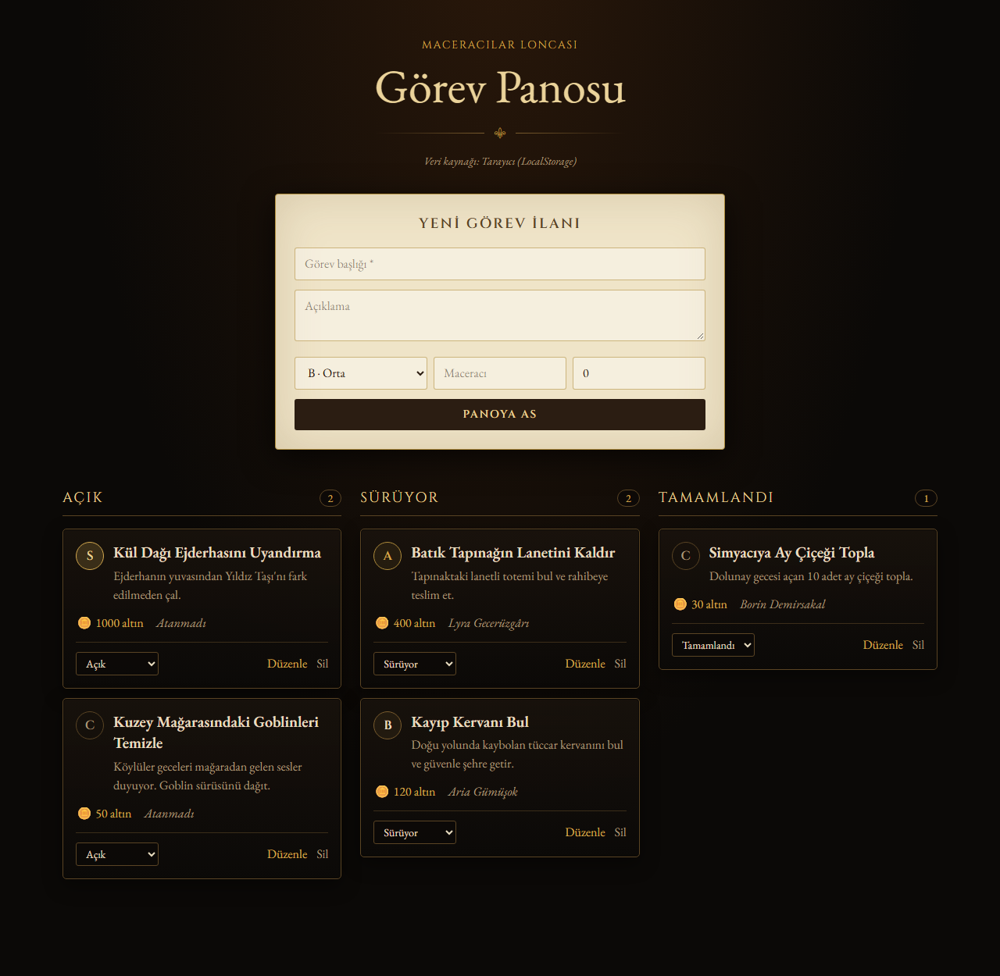

# 🗡️ Lonca — Görev Panosu (Web)

Maceracılar loncasının görev panosu. Lonca ustası yeni görev ilanları asar, görevleri maceracılara atar,
önceliklerini (S/A/B/C rütbesi) belirler ve görevleri *Açık → Sürüyor → Tamamlandı* sütunları arasında taşır.

🔗 **Canlı demo:** <!-- TODO: Netlify linki -->



## Özellikler (CRUD)

| İşlem | Nasıl? |
|---|---|
| **Ekle** | Üstteki "Yeni Görev İlanı" formu |
| **Listele** | Duruma göre üç sütunlu pano, önceliğe göre sıralı |
| **Güncelle** | Karttaki "Düzenle" butonu veya durum menüsü |
| **Sil** | Karttaki "Sil" butonu (onaylı) |

## Teknolojiler

- **React 19** + **Vite**
- **Tailwind CSS v4**
- **LocalStorage** ile kalıcı veri — isteğe bağlı olarak lonca-api REST API'sine bağlanabilir

## Kurulum

```bash
git clone https://github.com/dckaratas/lonca-web.git
cd lonca-web
npm install
npm run dev
```

Tarayıcıda `http://localhost:5173` adresini açın.

### API'ye bağlanmak (isteğe bağlı)

`.env.example` dosyasını `.env` olarak kopyalayıp API adresini yazın:

```
VITE_API_URL=http://localhost:3000
```

Değişken boşsa uygulama tarayıcının LocalStorage'ını kullanır.

## Klasör Yapısı

```
src/
├── components/   # Header, TaskCard, TaskForm, PriorityBadge
├── pages/        # TaskBoard (ana sayfa)
├── interfaces/   # Task veri modeli, öncelik (rütbe) ve durum sabitleri
└── services/     # taskService (LocalStorage / API), başlangıç verisi
```

## Yayına Alma (Netlify)

`netlify.toml` hazırdır: build komutu `npm run build`, yayın klasörü `dist`.
GitHub reposunu Netlify'a bağlamak yeterlidir.
